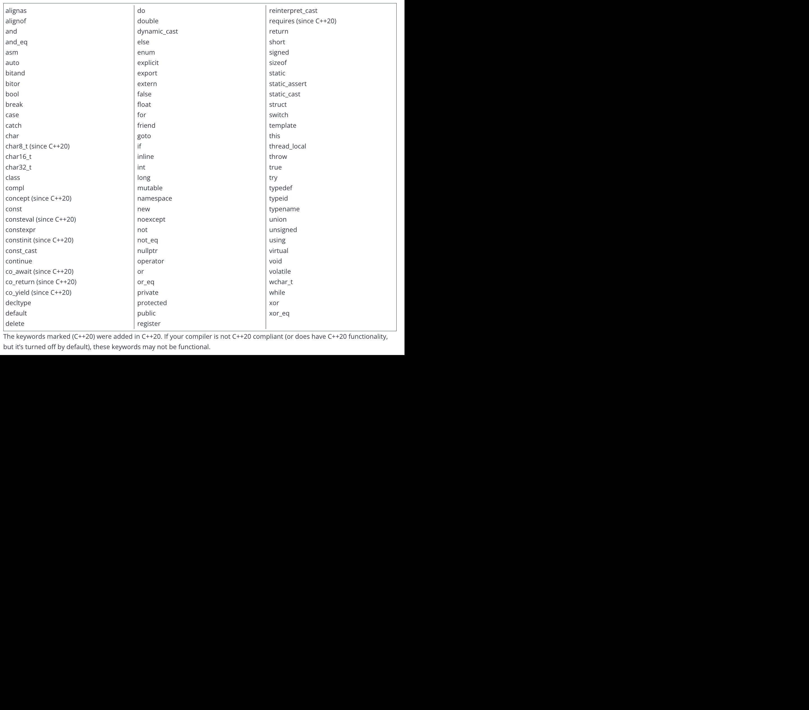

# 1.1

# 1.2 - Comments

- Single Line Comments: `//``

- Multi-line Comments: `/* comment */`

# 1.3 - Introduction to Objects and Variables

- Objects access memory.
- Object is called a variable.
- Variables have:
  - Identifier: Name of a variable
  - Type: Data type of the data in a variable
  - Value: The data within a variable
  - & more...
- Variables are created at Runtime when memory is allocated of their use.

# 1.4 - Variable Assignment and Initialization

- Assignment: Give a variable a value at some point after the variable is created.
- Initialization: Gives a variable a value at the time it is created.

1. Default: `int a;` (no initializer)
2. Traditional Initialization:
   - Copy Initialization: `int b = 5;`
   - Direct Initialization: `int c ( 6 );`
3. Modern Initialization:
   - Direct-list Initialization (direct brace): `int d { 7 };`
   - Value Initialization: `int e {}`(empty braces)
    - In most cases will perfrom **zero initialization**

- `[[maybe_unused]]` is a attribute applied at variable initialization that voids warnings for unused variables in code.
    - `[[maybe_unused]] double gravity { 9.8 }`

# 1.5 - Introduction to iostream: cout, cin, and endl

- `iostream`: input/output library part of the C++ standard library. 

- `std::cout`: Send data to the console to be printed as text. Character output.
    - Buffered -> Data is not sent to the console immediately but instead gathered into a buffer and *flushed* at times to the console.

- `<<`: Insertion operator, data flows in the direction of the arrows.
    - `std::cout << 4` sends the data 4 to the cout variable to be displayed in the console.

- `std::endl` Used to output a newline or linefeed while also *flushing* the `cout` buffer.
    - Flushing is very expensive and repeated flushing caused by `std::endl` can be inefficient.

- `\n`: Newline or linefeed escape character that creates a newline and moves the cursor but does NOT flush the `cout` buffer.

```cpp
#include <iostream> // for std::cout

int main()
{
    int x{ 5 };
    std::cout << "x is equal to: " << x << '\n'; // single quoted (by itself) (conventional)
    std::cout << "Yep." << "\n";                 // double quoted (by itself) (unconventional but okay)
    std::cout << "And that's all, folks!\n";     // between double quotes in existing text (conventional)
    return 0;
}
```


- `std::cin`: Character Input, reads input from the keyboard. 
    - Buffered -> Data from each output request is added to the end of an output buffer (FIFO).
        - Data, starting from the front, is collected to the input buffer.
- `<<`: Extraction Operator, data flows in the direction of the arrows, providing the data from `std::cin` to a variable.
    - `std::cin >> x` -> reads the data from `cin` into `x`.
    - Via Copy Assignment (`int x = value`) so there is **narrowing conversions** (decimals are dropped)!!

```cpp
#include <iostream>  // for std::cout and std::cin

int main()
{
    std::cout << "Enter two numbers: ";

    int x{};
    std::cin >> x;

    int y{};
    std::cin >> y;

    std::cout << "You entered " << x << " and " << y << '\n';

    return 0;
}
```


# 1.6 - Uninitialized Variables and Undefined Behavior

- Uninitialized Variable: A variable that has not bee given a known value (through initialization or assignment).

- Undefined Behavior: Executing code whose behavior is not well-defined by the C++ language.
    - Printing an uninitialized variable that results in a garbage value.

- Implementation-defined Behavior: Behavior that is defined by an **implementation**.
    - Implementation: A specific compiler and the associated standary library it comes with.
    - Using `sizeof` (number of bytes in a data type) on an `int` can product either 4 or 2 depending on the implementation. 

- Unspecified Behavior: Behavior is left up to the implementation to define, but the implementation is not required to document the behavior.

# 1.7 - Keywords and Naming Identifiers

- C++ has 92 keywords


- Special Identifiers:
    - `override`
    - `final`
    - `import`
    - `module`

# 1.8 - Whitespace and Basic Formatting

- Whitespace: Characters that are used for formatting purposes. In C++, this refers primarily to spaces, tabs, and newlines. Whitespace in C++ is generally used for 3 things: separating certain language elements, inside text, and for formatting code.

# 1.9 - Introduction to Literals and Operators

- Literals: Values that are inserted directly into the source code. These values usually appear directly in the executable code (unless they are optimized out).

- Operators: Characters that have special fucntionality in C++.

- Operator Arity:
    - Unary: operators act on one operand. 
        - `-5`
    - Binary: operators act on two operands.
        - `5 + 5`
    - Ternary: operators act on three operands.
        - The **conditional** operator in C++
    - Nullary: operatos act on zero operands.
        - The `throw` operator.
    
# 1.10 - Introduction to Expression

- Expression: A non-empty sequence of literals, variables, operators, and function calls that calculates a value.

- Expression Statement: A statement that consists of an expression followed by a semicolon.

# 1.11 - Developing Your First Program
