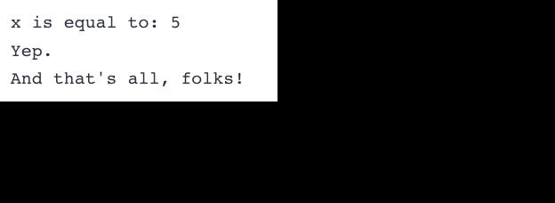

# 1.1

# 1.2 - Comments

- Single Line Comments: `//``

- Multi-line Comments: `/* comment */`

# 1.3 - Introduction to Objects and Variables

- Objects access memory.
- Object is called a variable.
- Variables have:
  - Identifier: Name of a variable
  - Type: Data type of the data in a variable
  - Value: The data within a variable
  - & more...
- Variables are created at Runtime when memory is allocated of their use.

# 1.4 - Variable Assignment and Initialization

- Assignment: Give a variable a value at some point after the variable is created.
- Initialization: Gives a variable a value at the time it is created.

1. Default: `int a;` (no initializer)
2. Traditional Initialization:
   - Copy Initialization: `int b = 5;`
   - Direct Initialization: `int c ( 6 );`
3. Modern Initialization:
   - Direct-list Initialization (direct brace): `int d { 7 };`
   - Value Initialization: `int e {}`(empty braces)
    - In most cases will perfrom **zero initialization**

- `[[maybe_unused]]` is a attribute applied at variable initialization that voids warnings for unused variables in code.
    - `[[maybe_unused]] double gravity { 9.8 }`

# 1.5 - Introduction to iostream: cout, cin, and endl

- `iostream`: input/output library part of the C++ standard library. 

- `std::cout`: Send data to the console to be printed as text. Character output.
    - Buffered -> Data is not sent to the console immediately but instead gathered into a buffer and *flushed* at times to the console.

- `<<`: Insertion operator, data flows in the direction of the arrows.
    - `std::cout << 4` sends the data 4 to the cout variable to be displayed in the console.

- `std::endl` Used to output a newline or linefeed while also *flushing* the `cout` buffer.
    - Flushing is very expensive and repeated flushing caused by `std::endl` can be inefficient.

- `\n`: Newline or linefeed escape character that creates a newline and moves the cursor but does NOT flush the `cout` buffer.

```cpp
#include <iostream> // for std::cout

int main()
{
    int x{ 5 };
    std::cout << "x is equal to: " << x << '\n'; // single quoted (by itself) (conventional)
    std::cout << "Yep." << "\n";                 // double quoted (by itself) (unconventional but okay)
    std::cout << "And that's all, folks!\n";     // between double quotes in existing text (conventional)
    return 0;
}
```


- `std::cin`: Character Input, reads input from the keyboard. 
    - Buffered -> Data from each output request is added to the end of an output buffer (FIFO).
        - Data, starting from the front, is collected to the input buffer.
- `<<`: Extraction Operator, data flows in the direction of the arrows, providing the data from `std::cin` to a variable.
    - `std::cin >> x` -> reads the data from `cin` into `x`.
    - Via Copy Assignment (`int x = value`) so there is **narrowing conversions** (decimals are dropped)!!

```cpp
#include <iostream>  // for std::cout and std::cin

int main()
{
    std::cout << "Enter two numbers: ";

    int x{};
    std::cin >> x;

    int y{};
    std::cin >> y;

    std::cout << "You entered " << x << " and " << y << '\n';

    return 0;
}
```