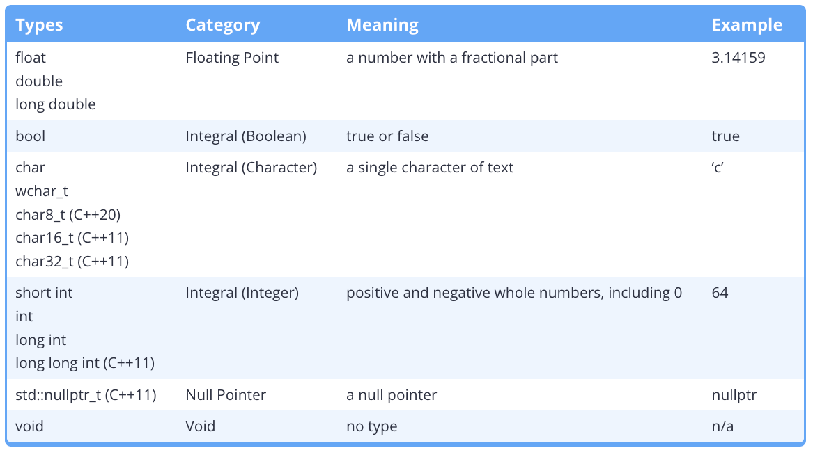
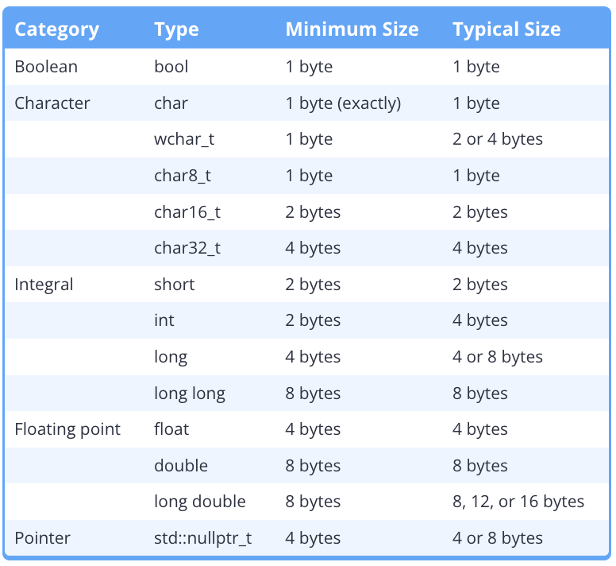
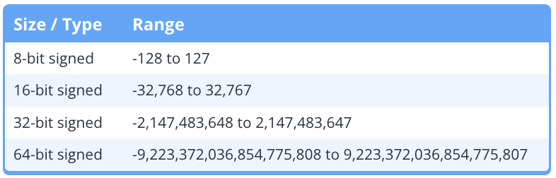
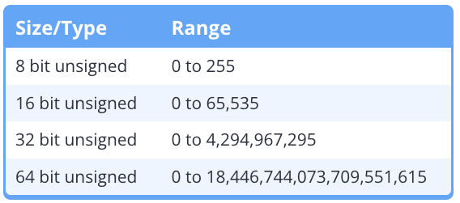

# 4.1 - Introduction to Fundamental Data Types

- Bit: The smallest unit of memory, which can hold a value of 0 or 1. 

- Memory Addresses: Sequential units used to store binary data.

- Byte: A group of bits that are operated on as a unit. 
    - 8 sequential bits.

- Data Type: A label used to tell the compiler how to interpret the contents of memory (bytes) in some meaningful way.

- Fundamental Data Types: The most basic data types provided by C++.

- Compound Data Types: More complex data types and allow for the creation of custom types.

- Integral: In the context of C++, means "like an integer".
    - All integral types are stored in memory as integer values, but only the standard integer types will display as an integer value when output. 

- Standard Integer Types:
    - `short`, `int`, `long`, `long long`
- Integral Types:
    - `bool`, `char`, standard integer types.
    - Fundamental types

- `_t` Suffix indicates a type.

# 4.2 - Void

- Incomplete Type: A type that has been declared but not yet defined. 
    - The compiler knows of the type but not how much memory to allocate for objects of that type.
    - Cannot be instantiated.

- `void`: An incomplete type that represents the lack of a type and thus cannot be defined.
    - Used to declare a function has no return value.

# 4.3 - Object Sizes and the `sizeof` operator

- `sizeof`: A unary operator that takes either a type or a variable, and returns the size of an object of that type (in bytes).
    - Does NOT include dynamically allocated memory used by an object.

# 4.4 - Signed Integers 

- Sign: The indication an integer is either positive or negative, typically represented as `-` for negative values.

- Signed Integers: Integer values that can be either positive, negative, or zero.

- Range: The spread of values that a data type can hold depending upon its size (in bits) and its sign. 
    - `-(2^(n-1)) to (2^(n-1)) - 1`

- Two's Complement: The de-facto standard for modern architectures, required by C++20, binary representation.
    - Flip bits then add 1 (binary)

- Integer Overflow (Arithmetic Overflow): An arithmetic operation (such as addition or multiplication) attempts to create a value outside the range that can be represented.

# 4.5 - Unsigned Integers and Why to Avoid Them

- Unsigned Integers: Integers that can only hold non-negative whole numbers.
    - `0 to (2^n) - 1`

