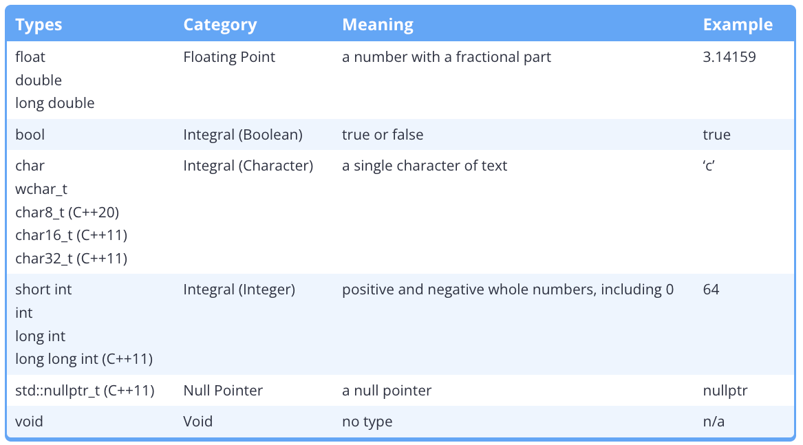
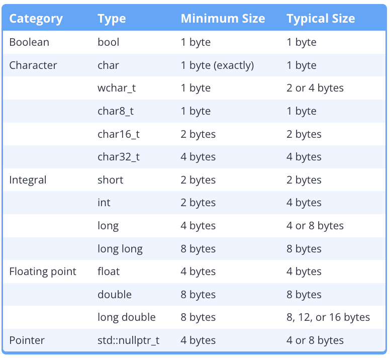
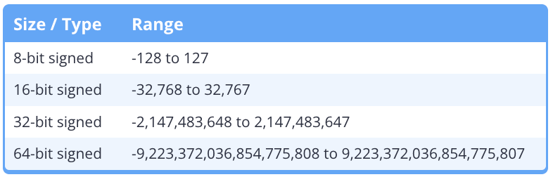
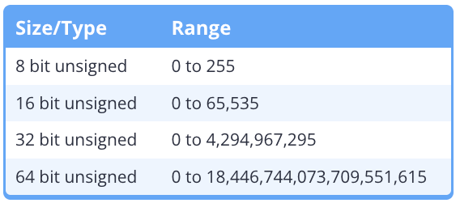
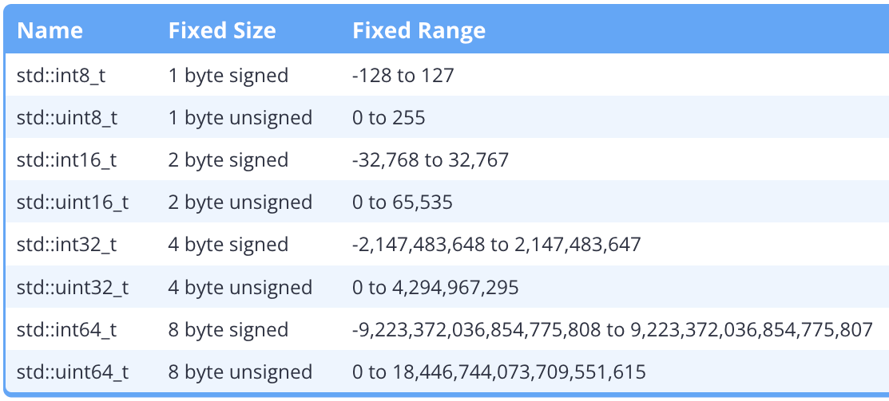
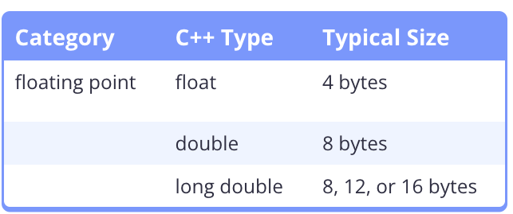
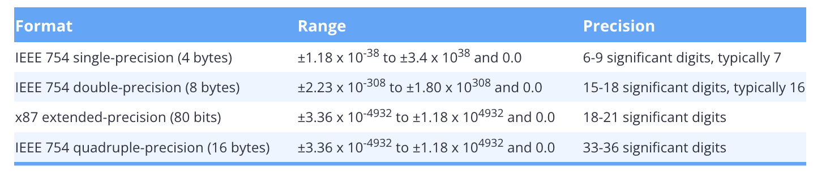
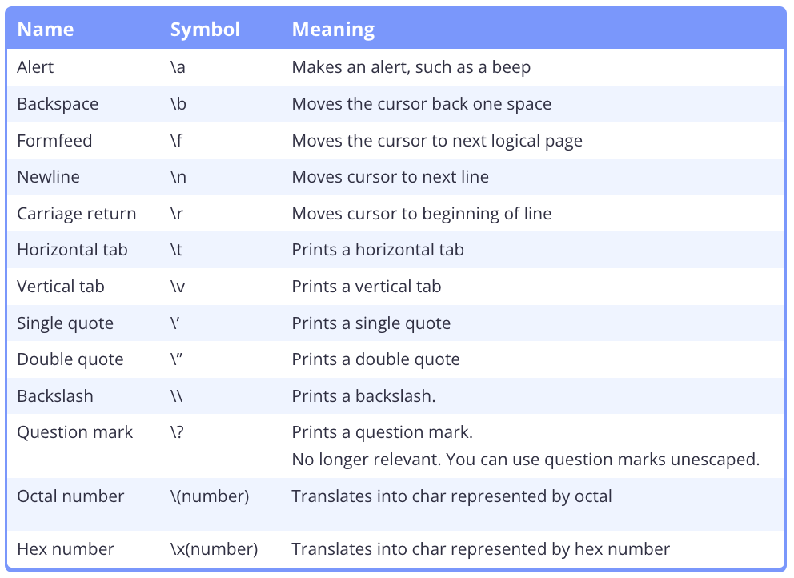

# 4.1 - Introduction to Fundamental Data Types

- Bit: The smallest unit of memory, which can hold a value of 0 or 1. 

- Memory Addresses: Sequential units used to store binary data.

- Byte: A group of bits that are operated on as a unit. 
    - 8 sequential bits.

- Data Type: A label used to tell the compiler how to interpret the contents of memory (bytes) in some meaningful way.

- Fundamental Data Types: The most basic data types provided by C++.


- Compound Data Types: More complex data types and allow for the creation of custom types.

- Integral: In the context of C++, means "like an integer".
    - All integral types are stored in memory as integer values, but only the standard integer types will display as an integer value when output. 

- Standard Integer Types:
    - `short`, `int`, `long`, `long long`
- Integral Types:
    - `bool`, `char`, standard integer types.
    - Fundamental types

- `_t` Suffix indicates a type.

# 4.2 - Void

- Incomplete Type: A type that has been declared but not yet defined. 
    - The compiler knows of the type but not how much memory to allocate for objects of that type.
    - Cannot be instantiated.

- `void`: An incomplete type that represents the lack of a type and thus cannot be defined.
    - Used to declare a function has no return value.


# 4.3 - Object Sizes and the `sizeof` operator



- `sizeof`: A unary operator that takes either a type or a variable, and returns the size of an object of that type (in bytes).
    - Does NOT include dynamically allocated memory used by an object.

# 4.4 - Signed Integers 


- Sign: The indication an integer is either positive or negative, typically represented as `-` for negative values.

- Signed Integers: Integer values that can be either positive, negative, or zero.

- Range: The spread of values that a data type can hold depending upon its size (in bits) and its sign. 
    - `-(2^(n-1)) to (2^(n-1)) - 1`



- Two's Complement: The de-facto standard for modern architectures, required by C++20, binary representation.
    - Flip bits then add 1 (binary)

- Integer Overflow (Arithmetic Overflow): An arithmetic operation (such as addition or multiplication) attempts to create a value outside the range that can be represented.

# 4.5 - Unsigned Integers and Why to Avoid Them

- Unsigned Integers: Integers that can only hold non-negative whole numbers.
    - `0 to (2^n) - 1`



# 4.6 - Fixed-width Integers and `size_t``

- Fixed-width Integers: C++11 introduced a set of integer types that are guaranteed to be the same size on any architecture.
    - Defined in the `<cstdint>` header.



- `std::int8_t` and `std::uint8_t` typically behave like `chars`.
    - Fixed-width integers do not defined new types but instead are aliases for the compiler and standard library to determine which existing type is aliased.

- The Fast Types: Provide the fastest signed/unsigned integer type with a width of at least # bits (where # = 8, 16, 32, or 64).
    - `std::int_fast32_t` will give you the fastest signed integer type that’s at least 32-bits. By fastest, we mean the integral type that can be processed most quickly by the CPU.

- The Least Types: Provide the smallest signed/unsigned integer type with a width of at least # bits (where # = 8, 16, 32, or 64). 
    - `std::uint_least32_t` will give you the smallest unsigned integer type that’s at least 32-bits.

- `std::size_t`: an alias for an implementation-defined unsigned integral type. It is used within the standard library to represent the byte-size or length of objects.
    - `<cstddef>` header
    - Guaranteed to be unsigned and at least 16 bits, but on most systems will be equivalent to the address-width of the application.
        - 32-bit applications`std::size_t` will typically be a 32-bit unsigned integer.
        - 64-bit application, `std::size_t` will typically be a 64-bit unsigned integer.
    - Some compilers limit the largest creatable object to half the maximum value of `std::size_t`

# 4.7 - Introduction to Scientfic Notation

# 4.8 - Floating Point Numbers

- Floating Point: Variable that can hold a number with a fractional component, such as 4320.0, -3.33, or 0.01226.
    - Always signed.



- `long double` size varies and it may not use an `IEEE 754` compliant format.
    - Avoid using `long double``

- Floating point literals default to `double`.
    - `f` suffix is used to denote a literal `float` type. 



- `std::cout` has 6 digits of precision for printing floating-point types. 
    - Will switch to scientific notation at some point as the number precision grows.
    - Can manipulate `std::cout` to output more precision by using an `output manipulator` function named `std::setprecision()`

- Output Manipulators: Alter how data is output and is are defined in the `iomanip` header.
    - Sticky, if you set them, they remain set.

```cpp
#include <iomanip> // for output manipulator std::setprecision()
#include <iostream>

int main()
{
    std::cout << std::setprecision(17); // show 17 digits of precision
    std::cout << 3.33333333333333333333333333333333333333f <<'\n'; // f suffix means float
    std::cout << 3.33333333333333333333333333333333333333 << '\n'; // no suffix means double

    return 0;
}
/* output
3.3333332538604736 float type less precision
3.3333333333333335 double type more precision but still not enough to 17 digits!
*/

```

- `Inf`: Represents infinity. Inf is signed, and can be positive (+Inf) or negative (-Inf).
- `NaN`: stands for “Not a Number”. There are several different kinds of `NaN`.
- Signed Zero: Separate representations for “positive zero” (+0.0) and “negative zero” (-0.0).

# 4.9 - Boolean Values

- Boolean Type: Boolean variables are variables that can have only two possible values: true, and false.

- `std::boolalpha`: Output manipulator that outputs the booleans as "true" or "false".
    - `std::noboolalpha` to turn it back off.

# 4.10 - Introduction to `if` Statements

- `if statement`: Execute one (or more) lines of code only if some condition is true.

- Condition: is an expression that evaluates to a Boolean value.

# 4.11 - Chars

- `char`: Designed to hold a single character. 
    - Characater: Can be a single letter, number, symbol, or whitespace.
    - Integral type, the underlying value is stored as an integer.
    - Integer stored by a `char` variable are interpreted as an ASCII character.

- ASCII: American Standard Code for Information Interchange

- `std::cin.get()` function does not ignore leading whitespace and will extract the whitespsace.

- Escape Sequences: Starts with a `\` (backslash) character, and then a following letter or number.



- Multicharacter Literals: `char` literals that contain multiple characters ('56').
    - Implementation defined by the compiler, recommended to avoid.

- Unicode: Well-known character mapping other than ASCII, which maps over 144,000 integer to characters in many languages.
    - Requires **32-bits** to represent characters (UTF-32).
    - Unicode can also be encoded using 16-bit (UTF-16) or 8-bit (UTF-8) characters.

- `char8_t`: Used to support UTF-8 characters
- `char16_t`: Used to support UTF-16 characters
- `char32_t`: Used to support UTF-32 characters
- `wchar_t`: Used to support Windows API

# 4.12 - Introduction to Type Conversion and `static_cast`

- Type Conversion: The process of converting data from one type to another type.
    - Implicit Type Conversion: When the compiler will convert a value for us.
    - Type conversions produce a **new value**!
        - The conversion takes in the variable as input and returns a temporary object that is the implicit type conversion of the input. 
        - `const_cast` and `reinterpret_cast` do not return temporary objects, but instead reinterpret the type of the existing value or object.

- Explicit Type Conversion: Allow us (the programmer) to explicitly tell the compiler to convert a value from one type to another type, and that we take full responsibility for the result of that conversion. 

- `static_cast`: Operator used for explicit conversions.
    - `static_cast<new_type>(expression)`
    