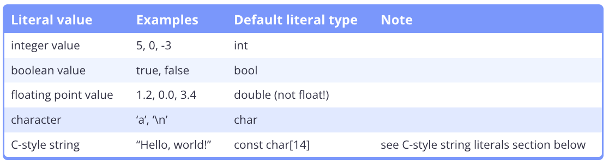
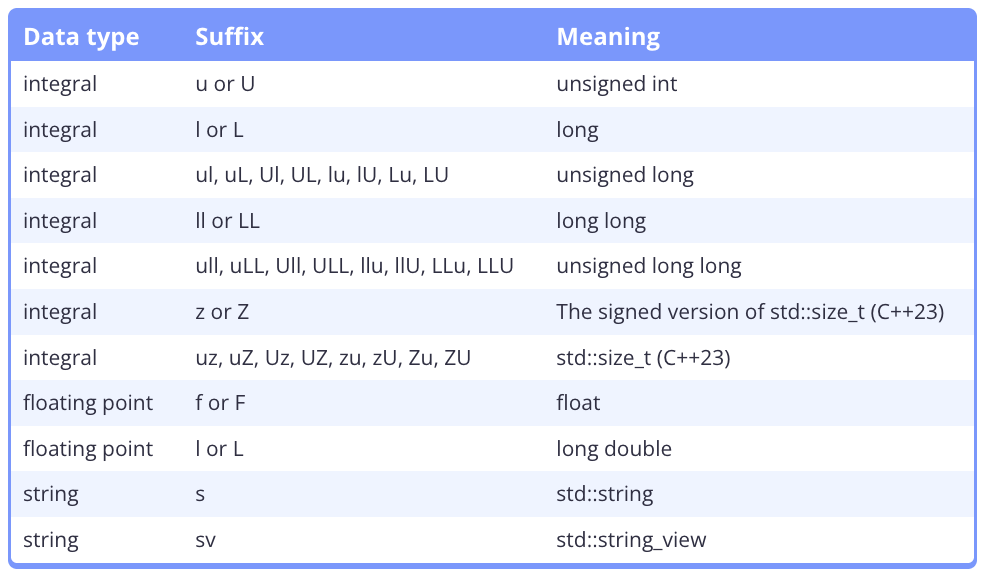

# 5.1 - Constant Variables (Named Constants)

- Constant: Value that may not be changed during the programs execution.
    - Named Constants (Symbolic Constants): Constant values that are associated with an identifier.
    - Literal Constants: Constant values that are not associated with an identifier.

- Constant Variables: A variable whose value cannot be changed after initialization.
    - `const` next to the object type.
    - Must be initialized when defined!

- Type Qualifiers: A keyword that is applied to a type that modifies how that type behaves.
    - `const` is a **const type qualifier**.
    - C++23 has 2 type qualifers: 
        1. `const`: Setting values constant.
        2. `volatile`: Used to tell the compiler that an object may have its value changed at any time.
        - Often referred as `cv-qualifiers`

# 5.2 - Literals

- Literals: Values that are inserted directly into the code.

- Literal Constants: Literals are sometimes called literal constants because their meaning cannot be redefined 



- Literal Suffixes: Add a suffix to a literal to change its deduced type.



- String: Collection of sequential characters used to represent text (such as names, words, and sentences).

- String Literal: C-style string literals are `const` objects that are created at the start of the program and are guaranteed to exist for the entirety of the program.

- Null Terminator `\0`: Character with ASCII Code 0, used to indicate the end of the string. 
    - String that ends with a null terminator is called a **null-terminated string**.

- Magic Number: A literal (usually a number) that either has an unclear meaning or may need to be changed later.
    - Avoid magic numbers.

# 5.3 - Numeral Systems (Decimal, Binary, Hexadecimal, Octal)

# 5.4 - The as-if Rule and Compile-time Optimization

- Profiler: A program that is used to determine how long certain parts of a program are taking to run and which are impacting overall performance.

- Optimizer: A program that optimizes another program.

- As-If Rule: The compiler can modify a program however it likes in order to produce more optimized code, so long as those modifications do not affect a program’s “observable behavior”.

- Compile-time Evaluation: When the compiler fully or partially evaluates an expression at compile-time.
    - Constant Folding: An optimization technique where the compiler replaces expressions that have **literal operands** with the result of the expression.
        - `int x{3 + 4}` is replaced with `x{7}``
    - Constant Propagation: An optimization technique where the compiler replaces **variables** known to have constant values with their values. 
    - Dead Code Elimination: An optimization technique where the compiler removes code that may be executed but has no effect on the program’s behavior.
        - Unused variables (optimized out/away)
    
- Use `const` variables to help the compiler predetermine variable status and improve compiler optimization.


# 5.5 - Constant Expressions

- `constexpr`: Variable constant type that requires an initializer that can be evaluated at compile-time. 

```cpp
int main()
{
    constexpr int x { expr }; // Because variable x is constexpr, expr must be evaluatable at compile-time
}
```

- Compile-time Programming: The use of language features that result in compile-time evaluation.

- Constant Expressions: An expression that must be evaluatable at compile-time, along with rules that determine how the compiler should handle these expressions.
    - A non-empty sequence of literals, constant variables, operators, and function calls, all of which must be evaluatable at compile-time.


# 5.6 - `constexpr` Variables

- `constexpr`: A keyword used to specify that the variable is always a compile-time constant.
    - Must be initialized with a constant expression, or result in compilation error.
    - Can be used for **non-integral** types!

# 5.7 - Introduction to `std::string`

- `std::string`: Lives in the `<string>` header.
    - Can handle strings of different lengths via dynamically allocated memory.

- `std::getline()`: To read a full line of input into a string.
    - Requires two arguments: 
        1. `std::cin`
            - use `std::cin >> std::ws` as the first arguement to ignore leading whitespace.
        2. String variable.

- `std::ws`: An **input manipulator**, tells `std::cin` to ignore any leading whitespace before extraction. 

- Input Manipulator: Ways to alter how input is accepted.

- When extracting to a variable, the extraction operator (`>>`) ignores leading whitespace. It stops extracting when encountering non-leading whitespace.
    - `std::getline()` does not ignore leading whitespace. If you want it to ignore leading whitespace, pass `std::cin >> std::ws` as the first argument. It stops extracting when encountering a newline.

- Member Functions: A special type of function that is nested within a class `std::string` (`std::string::length()`).
    - Called with "dot" notation -> `my_string.length()`

- `std::string.length()`: A member function for `std::string` that returns the length of the string (null-terminator excluded).
    - Most likely returns a type `size_t`

- We can create string literals with type `std::string` by using a `s` suffix after the double-quoted string literal. The `s` must be lower case.
    - `std::literals::string_literals`

```cpp
#include <iostream>
#include <string> // for std::string

int main()
{
    using namespace std::string_literals; // easy access to the s suffix

    std::cout << "foo\n";   // no suffix is a C-style string literal
    std::cout << "goo\n"s;  // s suffix is a std::string literal

    return 0;
}
``` 