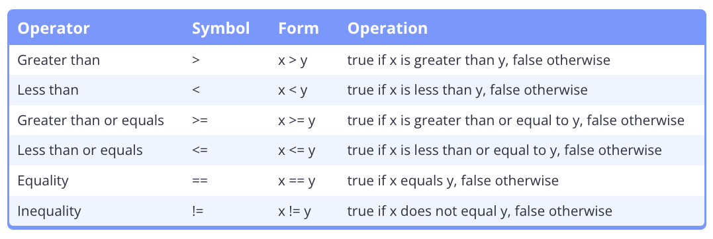
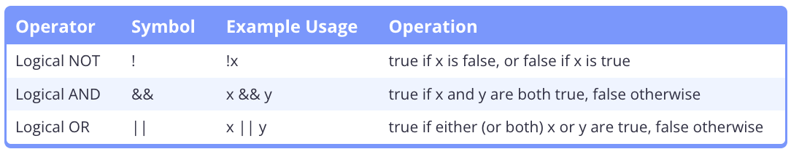

# 6.1 - Operator Precedence and Associativity.

- Precedence: A level indicator, ranking, or order for operators in expressions.
    - Operators with higher precendence levels are grouped first.

- Associativity: Tells the compiler whether to evaluate the operators (not the operands!) from left to right or from right to left. 

- Value Computation: The execution of operators in an expression to produce a value. 


- `GCC` evaluates function arguments in right to left order.
- `Clang` evaluates function arguments in left to right order.


- Quiz:
    a. `x = ((3 + 4) + 5)` equal precendence and L2R associativity.
    b. `x = (y = z)` equal precendence and R2L associativity.
    c. `z *= ((++y) + 5)` -> `++y` happens first, then (y' + 5), the z = z * (y' + 5).
    d. `(a || (b && c)) || d`

# 6.2 - Arithmetic Operators

- Floating-point Division: Division between two floating point values.
    - The decimal point (even `.0`) is kept.
    - `float` / `float` = `float`

- Integer Division: Divison between two integer values.
    - The decimal point value (if any) is dropped.
    - `int` / `int` = `int` 

- `static_cast<>` to cast the return of integer division to a float to keep the decimal.

- Modifying Operator: An operator that can modify the value of one of its operands.
    - Assignment/Bitwise Operators: `+=`, `<<=`, etc. 
    - Increment/Decrement Operators: `++` `--`

# 6.3 - Remainder and Exponentiation

- Modulo Operator (`%`): Returns the remainder after doing an integer division.
    - Only works with `int` operands!
    - Also works with **negative** operands. 
        - `x % y` returns a result with the sign of `x`.

- Exponentiation: No `^` operator so use `pow()` function inside `<cmath`.
    - `pow()` returns `double``
    - May not be precise due to the nature of floating-point rounding errors.
        - Best to maybe use your own function?
    

- Quiz:
    1. `8 = 6 + ((5 * 4) % 3)`
    2. 

# 6.4 - Increment/decrement Operators and Side Effects


- Side Effect: Some observable effect beyond producing a return value.
    - The assignment operators, prefix operator, and postfix operator have side effects that permanently change the value of an object.
    - Other operators (such as the arithmetic operators) return a value, and do not modify their operands.

# 6.5 - The Comma Operator


```cpp
#include <iostream>

int main()
{
    int x{ 1 };
    int y{ 2 };

    std::cout << (++x, ++y) << '\n'; // increment x and y, evaluates to the right operand

    return 0;
}


z = (a, b); // evaluate (a, b) first to get result of b, then assign that value to variable z.
z = a, b; // evaluates as "(z = a), b", so z gets assigned the value of a, and b is evaluated and discarded.
```

# 6.6 - The Conditional Operator

- Conditional Operator (`?:`): Sometimes called the **arithmetic if** operator is a ternary operator (an operator that takes 3 operands).
    - Provides a shorthand method for doing a particular type of if-else statement.
    - `condition ? expression1: expression2`

- The expression used in a conditional operator need to be either the same type or be able to be implicitly converted by the compiler to the same type (`int`->`double` etc.)

# 6.7 - Relational Operators and Floating Point Comparisons



- DO NOT compare floating point values of similar size/range of magnitude, as the precision errors can cause undefined behavior.
# 6.8 Logical Operators



- Short Circuit: Early exit from a conditional expression because condition 1 evaluation trumps all other evauluation and a return can be made. 
    - Ex. Using LogicalOR (`||`) and the first condition is true, the second condition will not and does not need to be evaluated. 

- De Morgan's Law: When you distribute the logical NOT, you also need to flip logical AND to logical OR, and vice-versa!
    - `!(x && y) == !x || !y`
    - `!(x || y) == !x && !y`


```cpp
// C++14/17/20 version
#include <algorithm> // for std::max
#include <iostream>

// Our own constexpr implementation of std::abs (for use in C++14/17/20)
// In C++23, use std::abs
// constAbs() can be called like a normal function, but can handle different types of values (e.g. int, double, etc...)
template <typename T>
constexpr T constAbs(T x)
{
    return (x < 0 ? -x : x);
}

// Return true if the difference between a and b is within epsilon percent of the larger of a and b
constexpr bool approximatelyEqualRel(double a, double b, double relEpsilon)
{
    return (constAbs(a - b) <= (std::max(constAbs(a), constAbs(b)) * relEpsilon));
}

// Return true if the difference between a and b is less than or equal to absEpsilon, or within relEpsilon percent of the larger of a and b
constexpr bool approximatelyEqualAbsRel(double a, double b, double absEpsilon, double relEpsilon)
{
    // Check if the numbers are really close -- needed when comparing numbers near zero.
    if (constAbs(a - b) <= absEpsilon)
        return true;

    // Otherwise fall back to Knuth's algorithm
    return approximatelyEqualRel(a, b, relEpsilon);
}

int main()
{
    // a is really close to 1.0, but has rounding errors
    constexpr double a{ 0.1 + 0.1 + 0.1 + 0.1 + 0.1 + 0.1 + 0.1 + 0.1 + 0.1 + 0.1 };

    constexpr double relEps { 1e-8 };
    constexpr double absEps { 1e-12 };

    std::cout << std::boolalpha; // print true or false instead of 1 or 0

    constexpr bool same { approximatelyEqualAbsRel(a, 1.0, absEps, relEps) };
    std::cout << same << '\n';

    return 0;
}
```

- `abs()` was not made `constexpr` until C++23. So you can use the above on older versions.