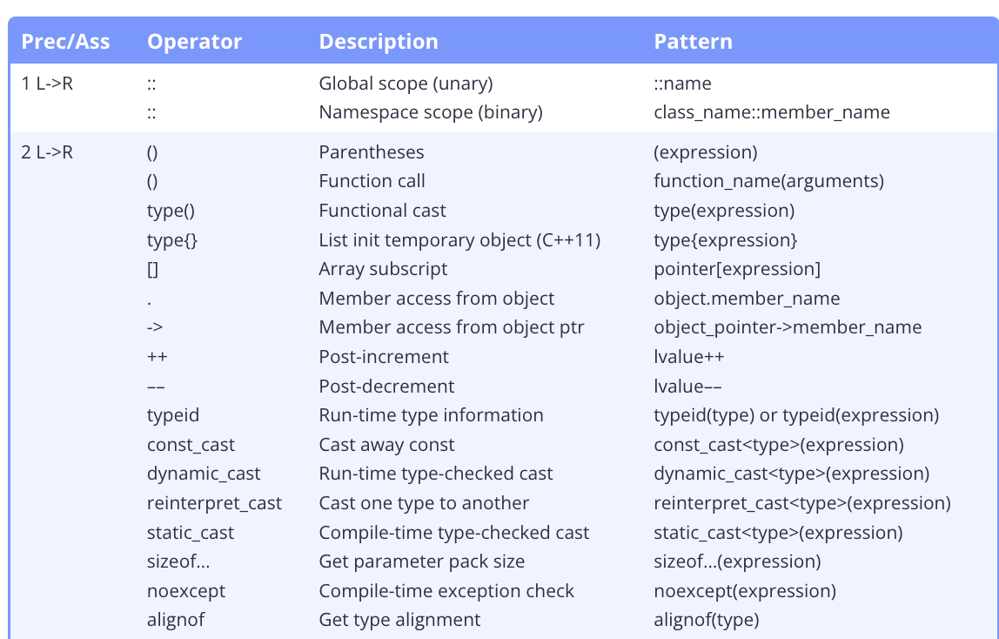
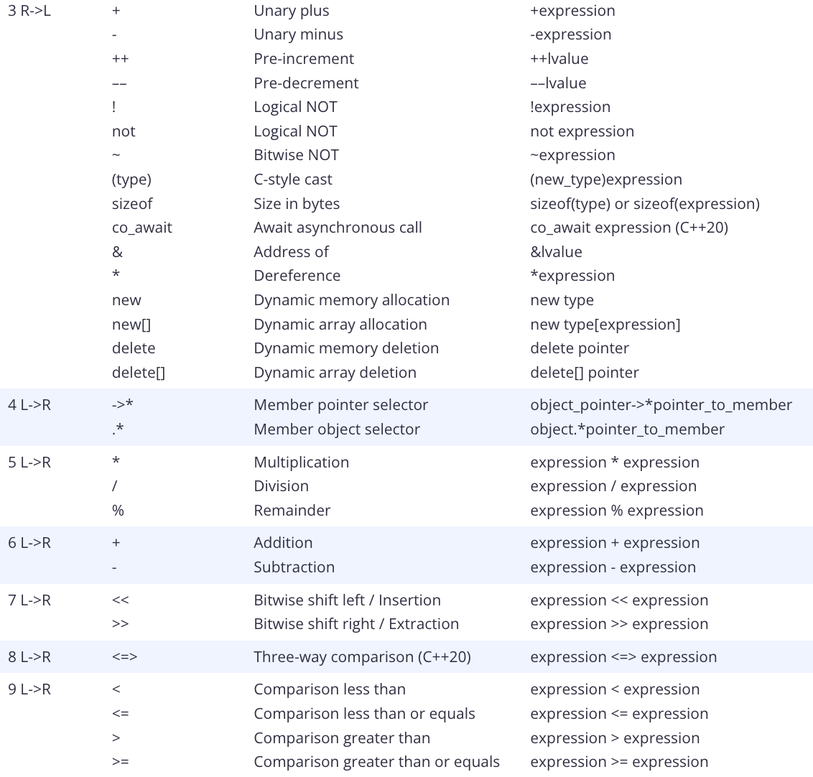
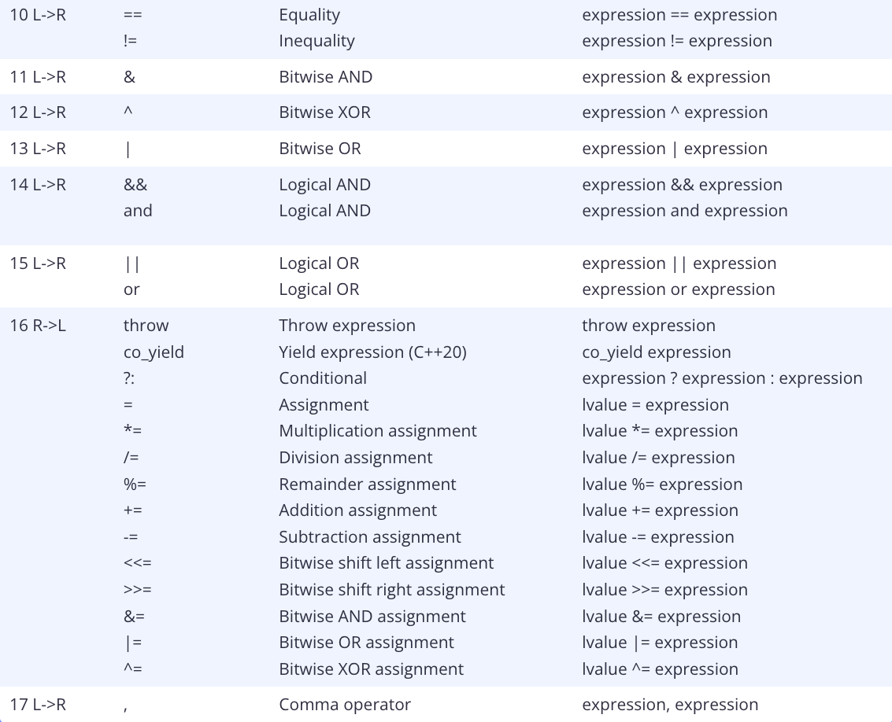
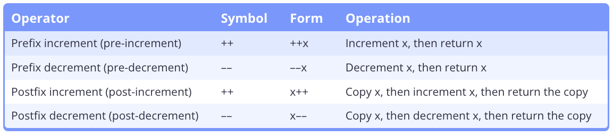
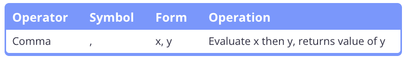

# 6.1 - Operator Precedence and Associativity.

- Precedence: A level indicator, ranking, or order for operators in expressions.
    - Operators with higher precendence levels are grouped first.

- Associativity: Tells the compiler whether to evaluate the operators (not the operands!) from left to right or from right to left. 

- Value Computation: The execution of operators in an expression to produce a value. 


- `GCC` evaluates function arguments in right to left order.
- `Clang` evaluates function arguments in left to right order.






- Quiz:
    a. `x = ((3 + 4) + 5)` equal precendence and L2R associativity.
    b. `x = (y = z)` equal precendence and R2L associativity.
    c. `z *= ((++y) + 5)` -> `++y` happens first, then (y' + 5), the z = z * (y' + 5).
    d. `(a || (b && c)) || d`

# 6.2 - Arithmetic Operators

- Floating-point Division: Division between two floating point values.
    - The decimal point (even `.0`) is kept.
    - `float` / `float` = `float`

- Integer Division: Divison between two integer values.
    - The decimal point value (if any) is dropped.
    - `int` / `int` = `int` 

- `static_cast<>` to cast the return of integer division to a float to keep the decimal.

- Modifying Operator: An operator that can modify the value of one of its operands.
    - Assignment/Bitwise Operators: `+=`, `<<=`, etc. 
    - Increment/Decrement Operators: `++` `--`

# 6.3 - Remainder and Exponentiation

- Modulo Operator (`%`): Returns the remainder after doing an integer division.
    - Only works with `int` operands!
    - Also works with **negative** operands. 
        - `x % y` returns a result with the sign of `x`.

- Exponentiation: No `^` operator so use `pow()` function inside `<cmath`.
    - `pow()` returns `double``
    - May not be precise due to the nature of floating-point rounding errors.
        - Best to maybe use your own function?
    

- Quiz:
    1. `8 = 6 + ((5 * 4) % 3)`
    2. 

# 6.4 - Increment/decrement Operators and Side Effects



- Side Effect: Some observable effect beyond producing a return value.
    - The assignment operators, prefix operator, and postfix operator have side effects that permanently change the value of an object.
    - Other operators (such as the arithmetic operators) return a value, and do not modify their operands.

# 6.5 - The Comma Operator



```cpp
#include <iostream>

int main()
{
    int x{ 1 };
    int y{ 2 };

    std::cout << (++x, ++y) << '\n'; // increment x and y, evaluates to the right operand

    return 0;
}


z = (a, b); // evaluate (a, b) first to get result of b, then assign that value to variable z.
z = a, b; // evaluates as "(z = a), b", so z gets assigned the value of a, and b is evaluated and discarded.
```

